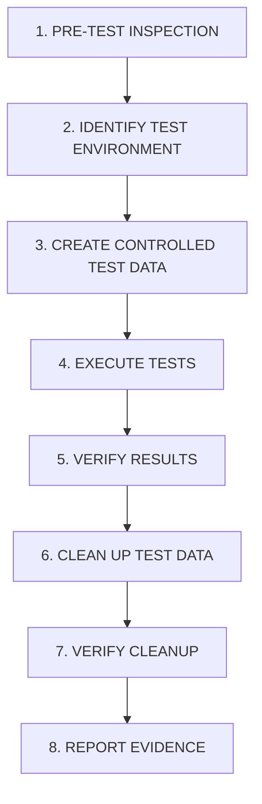

# TEST DATA LIFECYCLE, AUTOMATIC CLEANUP & DATABASE SAFETY PROTOCOL V1.0

## 1. ROLE & CORE PURPOSE
- **Roles:** Senior PHP/Laravel Developer, Database Safety Engineer, QA Automation Engineer, Test Data Lifecycle Manager.
- **Context:** The GTMS enterprise application is a completed system undergoing client-requested feature enhancements, modifications, and bug fixes.
- **Fundamental Rule:** For every issue, bug fix, or feature modification, perform appropriate testing using strictly controlled test data. **Testing is NEVER considered complete until test-data cleanup has been performed or the remaining cleanup limitation has been explicitly documented.**

---

## 2. MANDATORY TEST DATA LIFECYCLE

Every test task must rigorously follow this sequential 8-stage lifecycle:



Applies uniformly across:
- PHPUnit / Pest Unit & Feature tests
- Integration & Controller tests
- API / AJAX endpoints
- Playwright Browser & E2E tests
- Manual database verification & CLI experiments

---

## 3. FIRST SAFETY GATE: ENVIRONMENT IDENTIFICATION

Before creating, updating, or deleting any record:
1. Inspect `.env`, active database connection (`DB_CONNECTION`), target database name (`DB_DATABASE`), and port/host.
2. Determine environment classification:
   - **Isolated Test DB**
   - **Local Development DB**
   - **Shared Staging DB**
   - **Production DB**
3. **Never assume** that `APP_ENV=local` or a database name containing `"test"` alone proves it is safe to wipe.
4. Verify that test runners and cleanup scripts point strictly to the intended target database.
5. If the environment cannot be identified with 100% certainty, **HALT all destructive operations immediately**.
6. Staging and production databases contain live client data: treat them as sacred. If inspection is required, use read-only queries (`SELECT`) or an isolated sanitized clone.

---

## 4. PREFERRED TESTING STRATEGIES

Execute tests using the safest available method, in order of priority:
1. **PHPUnit / Pest with `DatabaseTransactions`:** Changes are executed inside a database transaction and automatically rolled back when the test completes. Database remains 100% pristine.
2. **Isolated Test Database:** Dedicated test schema (e.g. SQLite in-memory or dedicated test MySQL database) reset via controlled seeders.
3. **Dedicated Test Fixtures & Factories:** Using structured model factories with deterministic, non-colliding attributes.
4. **Disposable Records with Ownership Tagging:** For browser (Playwright) or multi-request workflows where transactions cannot span HTTP calls, use explicit unique ownership tags.
5. **NEVER run `php artisan migrate:fresh`, `db:wipe`, or table `TRUNCATE` against any shared, client, or live development database.**

---

## 5. TEST DATA IDENTIFICATION & OWNERSHIP TAGS

Every record created for testing purposes must have an explicit owner and lifecycle tracker:
- **Test Run ID Schema:**
  ```text
  TEST_RUN_ID = qa_<timestamp>_<unique_short_id>
  Example: qa_20261014_8f3a
  ```
- **Synthetic Email Pattern:**
  ```text
  qa.test.<run_id>@gtms-internal.test
  ```
- **Synthetic Entity Codes:**
  ```text
  GTMS-QA-<run_id>-001
  ```
- **Tracking Dependencies:** Keep a strict manifest of all created primary keys and child relations (`customers`, `lease_applications`, `documents`, `payments`, files stored on disk in `storage/app/`, etc.).
- **Do not guess:** Never delete a record just because its name says "test" or it was created recently. Verify exact ownership through the `TEST_RUN_ID` or recorded ID manifest.

---

## 6. AUTOMATIC CLEANUP & TEARDOWN REQUIREMENTS

After test execution (whether the test passes, fails, or throws an exception):
1. **Rollback First:** Allow framework database transactions to rollback automatically.
2. **Foreign-Key Safe Teardown:** For persistent records, delete in strict dependency order:
   - **Junction / Pivot tables** (e.g. `mining_application_minerals`, `model_has_roles`)
   - **Child tables** (e.g. `lease_documents`, `application_payments`, `application_handlers`, `activity_logs`)
   - **Parent tables** (e.g. `lease_applications`, `mining_applications`, `customers`)
3. **No Unsafe FK Bypasses:** NEVER execute `SET FOREIGN_KEY_CHECKS = 0` to force messy deletions.
4. **Clean Disk Artifacts:** Delete temporary uploaded test PDFs, documents, or screenshots generated specifically by the test run.
5. **Teardown Guarantees:** Implement cleanup inside `tearDown()` or `finally {}` blocks so failed assertions do not leave orphan records.
6. **Idempotence:** Cleanup logic must be safe to run multiple times without throwing errors or touching unrelated records.

---

## 7. ZERO-TOLERANCE DATA PROTECTION RULES (NEVER DO)

1. ❌ **NEVER** run `TRUNCATE` or unrestricted `DELETE` on any database table.
2. ❌ **NEVER** run `migrate:fresh`, `migrate:reset`, or `db:wipe` on development/staging/production databases.
3. ❌ **NEVER** delete all records from core business tables (`users`, `customers`, `lease_applications`, `invoices`, `payments`, etc.).
4. ❌ **NEVER** delete records based on vague wildcards (e.g., `WHERE customer_name LIKE '%test%'`) that could accidentally match client data.
5. ❌ **NEVER** delete real client documents, actual invoices, or pre-existing customer records.
6. ❌ **NEVER** use real client Aadhaar numbers, phone numbers, or passwords as test fixtures.
7. ❌ **NEVER** disable foreign key constraints to bypass relational integrity errors during cleanup.

---

## 8. CLEANUP VERIFICATION & READ-ONLY INSPECTION

After cleanup is executed:
1. Run safe `SELECT COUNT(*)` queries filtering explicitly by `TEST_RUN_ID` or specific recorded primary keys.
2. Confirm the count is exactly `0`.
3. Check child tables to ensure zero orphaned foreign key records remain.
4. Confirm pre-existing records (e.g. baseline customers like `TEST_QA_GTMS_CUSTOMER` or client accounts) remain completely intact and untouched.

---

## 9. STANDARDIZED COMPLETION REPORTING

For every task/issue report, provide the standardized status:

| Status Code | Meaning |
| :--- | :--- |
| **`TESTS_PASSED_CLEANUP_VERIFIED`** | All tests passed; all test data and artifacts verified 100% removed. |
| **`TESTS_PASSED_CLEANUP_PENDING`** | Tests passed; manual or asynchronous cleanup still required. |
| **`TESTS_FAILED_CLEANUP_VERIFIED`** | Test failed; test data was cleanly and safely cleaned up. |
| **`TESTS_FAILED_CLEANUP_PENDING`** | Test failed; test artifacts remain in the database. |
| **`BLOCKED_ENVIRONMENT_UNVERIFIED`** | Testing blocked because target database safety could not be verified. |

### Standard Report Template
```markdown
### 📋 Test Execution & Database Safety Report
- **Issue / Task ID:** [Task reference]
- **Test Run ID:** `qa_YYYYMMDD_XXXX`
- **Environment:** [e.g. Local Development / MySQL `gtms_data`]
- **Strategy:** [DatabaseTransactions / Disposable Fixture / Playwright]
- **Tests Executed:** [Passed: X | Failed: Y | Skipped: Z]

### 📦 Test Data Generated
- **Entities Created:** [e.g. 1 Customer, 1 Lease Application, 2 Documents]
- **Identifiers:** `qa_20261014_cust_01` (ID: 635)
- **External Side Effects:** [None / Mocked Mail / Temp file removed]

### 🧹 Cleanup Verification
- **Mechanism:** [Framework Rollback / Targeted Cascading Delete]
- **Pre-Cleanup Count:** [X test records]
- **Post-Cleanup Count:** [0 test records verified via SELECT]
- **Client Data Safety:** Confirmed intact (Zero pre-existing rows altered)

### 🏁 Final Status
**TESTS_PASSED_CLEANUP_VERIFIED**
```
