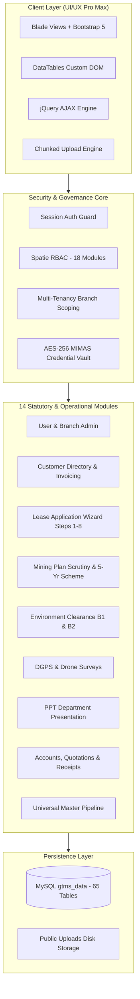

# 🧭 GTMS Enterprise Knowledge Library & Task Router

> **Welcome to the GTMS Knowledge Library.**  
> This directory serves as the centralized, token-optimized single source of truth for the **Government Tender & Mining Management System (GTMS)**.  
> **Rule for AI Agents & Developers:** Do NOT scan dozens of raw PHP, Blade, or JS files. Consult this router to load only the specific document needed for your current task, saving tens of thousands of tokens and eliminating guesswork.

---

## ⚡ Task-to-Document Router Matrix

Find your current task below and load the corresponding documentation file directly:

| What are you trying to do? | Target Document | File Link |
| :--- | :--- | :--- |
| 🆕 **Create a new page, CRUD feature, or module** | Step-by-step recipes with certified Model, Controller, Blade, and AJAX boilerplate | [NEW_PAGE_BOILERPLATE_RECIPES.md](file:///c:/xampp/htdocs/GTMS/gtms/docs/NEW_PAGE_BOILERPLATE_RECIPES.md) |
| 🌐 **Find an API endpoint, route name, or permission gate** | Quick reference table of all 94 routes, HTTP methods, controllers, and payload formats | [QUICK_API_ROUTES_CHEAT_SHEET.md](file:///c:/xampp/htdocs/GTMS/gtms/docs/QUICK_API_ROUTES_CHEAT_SHEET.md) |
| 🗄️ **Look up database table columns, types, or foreign keys** | Complete MySQL database dictionary of all 65 domain tables without running SQL queries | [DATABASE_SCHEMA_MINIMAL_REFERENCE.md](file:///c:/xampp/htdocs/GTMS/gtms/docs/DATABASE_SCHEMA_MINIMAL_REFERENCE.md) |
| 🔄 **Understand application workflows and state transitions** | State machine diagrams and transition tables for Lease, Mining, EC, and Master Pipeline | [WORKFLOW_STATE_MACHINE_REFERENCE.md](file:///c:/xampp/htdocs/GTMS/gtms/docs/WORKFLOW_STATE_MACHINE_REFERENCE.md) |
| 🔑 **Test login, run PHPUnit tests, or check seeders** | Demo account credentials, test suite commands, seeder classes, and maintenance commands | [SYSTEM_CREDENTIALS_AND_TEST_GUIDE.md](file:///c:/xampp/htdocs/GTMS/gtms/docs/SYSTEM_CREDENTIALS_AND_TEST_GUIDE.md) |
| 📋 **Audit forms, inputs, validations, or saving logic** | Exhaustive field-by-field audit of all 84 Blade views across all 14 statutory modules | [GTMS_PAGE_WISE_CRUD_AND_FORM_ARCHITECTURE.md](file:///c:/xampp/htdocs/GTMS/gtms/docs/GTMS_PAGE_WISE_CRUD_AND_FORM_ARCHITECTURE.md) |
| 🛠️ **Fix a bug, exception, or 403/419 error** | Fast troubleshooting playbook with root causes and instant 1-line fixes | [TROUBLESHOOTING_AND_COMMON_ERRORS.md](file:///c:/xampp/htdocs/GTMS/gtms/docs/TROUBLESHOOTING_AND_COMMON_ERRORS.md) |
| 🎨 **Style a page with GTMS UI/UX Pro Max tokens** | Copy-paste CSS tokens, squircle avatars, bento KPI cards, action docks, and status pills | [FRONTEND_UI_COMPONENT_CATALOG.md](file:///c:/xampp/htdocs/GTMS/gtms/docs/FRONTEND_UI_COMPONENT_CATALOG.md) |
| 🤖 **Verify documentation health & synchronization** | Automated Python test harness validating documentation against live code and database | [scripts/gtms_doc_doctor.py](file:///c:/xampp/htdocs/GTMS/gtms/scripts/gtms_doc_doctor.py) |

---

## 🏛️ GTMS High-Level System Architecture



---

## 📂 Documentation Library Structure

```text
docs/
├── README.md                                  # 👈 This Master Router & Index
├── QUICK_API_ROUTES_CHEAT_SHEET.md            # Concise 94-route cheat sheet
├── DATABASE_SCHEMA_MINIMAL_REFERENCE.md       # Live 65-table MySQL schema dictionary
├── NEW_PAGE_BOILERPLATE_RECIPES.md            # Copy-paste certified code templates
├── WORKFLOW_STATE_MACHINE_REFERENCE.md         # Mermaid diagrams & status transitions
├── SYSTEM_CREDENTIALS_AND_TEST_GUIDE.md       # Demo logins, test suites, artisan commands
├── GTMS_PAGE_WISE_CRUD_AND_FORM_ARCHITECTURE.md # Deep form & field manual audit
├── TROUBLESHOOTING_AND_COMMON_ERRORS.md       # Debugging & error resolution playbook
├── FRONTEND_UI_COMPONENT_CATALOG.md           # CSS design tokens & HTML UI snippets
└── project-knowledge/                         # 24 Deep technical reference files
```

---

## 💡 Best Practices for AI Agents Working on GTMS

1. **Token Conservation First:** Never prompt the coordinator or search the entire codebase for routes or schema. Always refer directly to the designated file in `docs/`.
2. **Preserve Dual RBAC Synchronization:** Always update both the direct `users.role_id` relational foreign key and Spatie's `model_has_roles` pivot table.
3. **Respect Branch Multi-Tenancy:** Every operational model must enforce `belongsTo(Branch::class)` and auto-inject `branch_id = auth()->user()->branch_id` for non-admin accounts.
4. **Never Store Plaintext Secrets:** Passwords and department portal logins must pass through `bcrypt()` or `Crypt::encryptString()`.
5. **Clean Up Files on Disk:** Whenever an entity with uploaded files (avatars, PDFs, drawings) is updated or deleted, ensure old files are safely unlinked via `unlink()`.
