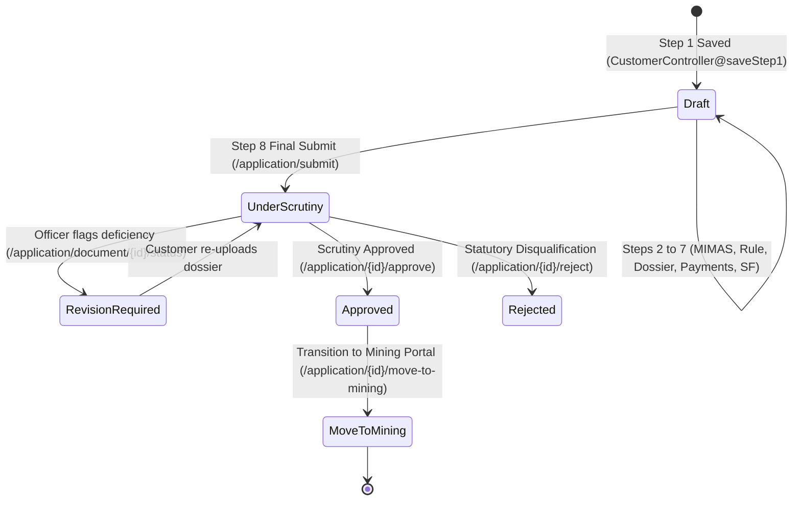
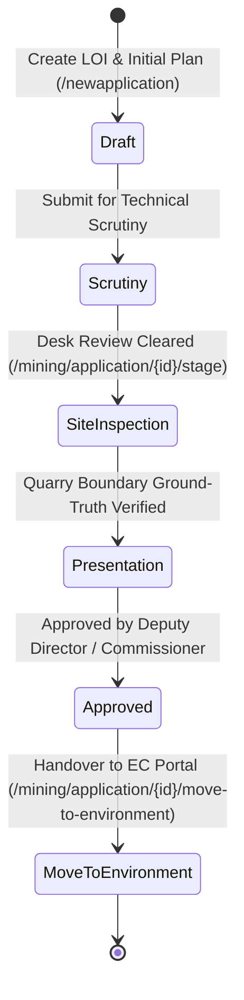
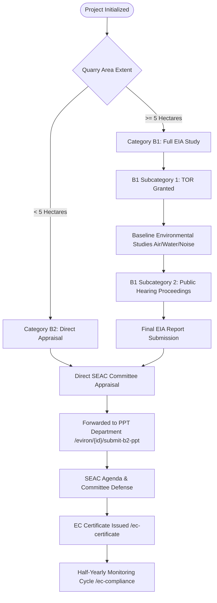
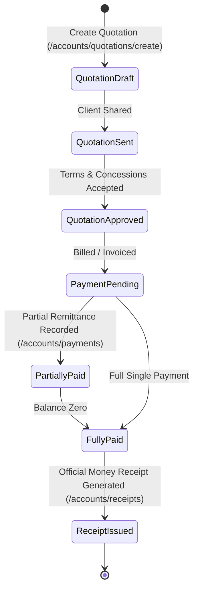

# 🔄 GTMS Workflow State Machine Reference
> **Token-Saver Reference:** Consult this state machine diagram and transition table to verify valid application statuses, allowed transitions, triggering actions, and required role privileges without guessing business logic.

---

## 1. Statutory Lease Application State Machine

### Transition Rules Table:
| Current Status | Target Status | Trigger Endpoint | Required Permission | DB Effect |
| :--- | :--- | :--- | :--- | :--- |
| `[None]` | `draft` | `POST /step1` | `application.create` | Creates row in `lease_applications` with `status = 'draft'`. |
| `draft` | `under_scrutiny` | `POST /application/submit` | `application.create` | Locks wizard editing; assigns master project tracking code. |
| `under_scrutiny` | `revision_required`| `POST /application/document/{id}/status` | `application.edit` | Sets specific document `status = 'reupload_requested'`. |
| `under_scrutiny` | `approved` | `POST /application/{id}/approve` | `application.edit` | Marks application fully compliant and scrutiny verified. |
| `under_scrutiny` | `rejected` | `POST /application/{id}/reject` | `application.edit` | Formal statutory rejection with order copy upload. |
| `approved` | `moved_to_mining` | `POST /application/{id}/move-to-mining` | `application.edit` | Hands over dossier and provisions new row in `mining_applications`. |

---

## 2. Mining Plan Portal State Machine

### Transition Stages:
1. `draft` ➔ Initial capture of LOI date and production target.
2. `scrutiny` ➔ Geological assessment and statutory checklist verification.
3. `inspection` ➔ Revenue and Mines field officer physical boundary verification.
4. `presentation` ➔ Technical presentation before the District Mining Committee.
5. `approved` ➔ Formal 5-year Mining Plan approval order issued.

---

## 3. Environment Clearance (EC) Workflow

---

## 4. Technical Surveys State Machine (DGPS & Drone)

### DGPS Survey Demarcation:
* `scheduled` ➔ Survey scheduled and field officer assigned.
* `in_progress` ➔ Base station calibrated and rover boundary coordinates captured.
* `coordinates_locked` ➔ Coordinates verified against revenue boundary records.
* `completed` ➔ Certified boundary sketch and area certificate generated.

### Drone Topography Survey:
* `scheduled` ➔ DGCA flight plan submitted.
* `flight_completed` ➔ Raw aerial photos acquired.
* `processing` ➔ Orthomosaic stitching and DEM generation in GIS engine.
* `deliverables_ready` ➔ GeoTIFF, DSM, Contours, and 3D Volumetric report available.

---

## 5. Accounts & Financial State Machine

---

## 6. Universal Master Pipeline Bidirectional Transitions

GTMS implements a resilient bidirectional state machine across all 7 statutory departments via `MasterPipelineController`:

| Action | HTTP Endpoint | Direction | Conditions & Rules |
| :--- | :--- | :--- | :--- |
| **Forward** | `POST /master-pipeline/forward/{id}` | Downstream (e.g. `Lease` ➔ `Mining` ➔ `Environment`) | Prior department must be `approved` or scrutiny cleared. |
| **Return** | `POST /master-pipeline/return/{id}` | Upstream (e.g. `PPT` ➔ `Mining`) | **Mandatory Scrutiny Remarks:** Requires non-empty explanation of reasons for defect or correction request. |
| **Resubmit** | `POST /master-pipeline/resubmit/{id}` | Downstream | Re-advances application after corrected files/dossiers are uploaded. |
