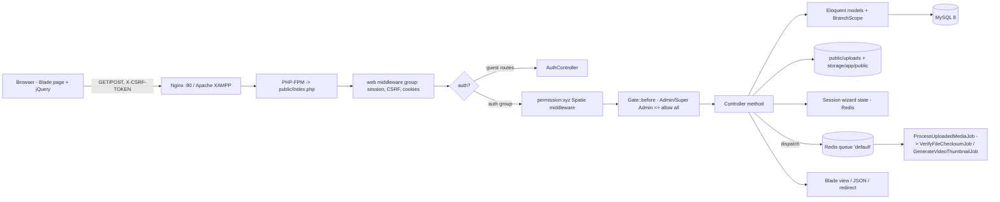
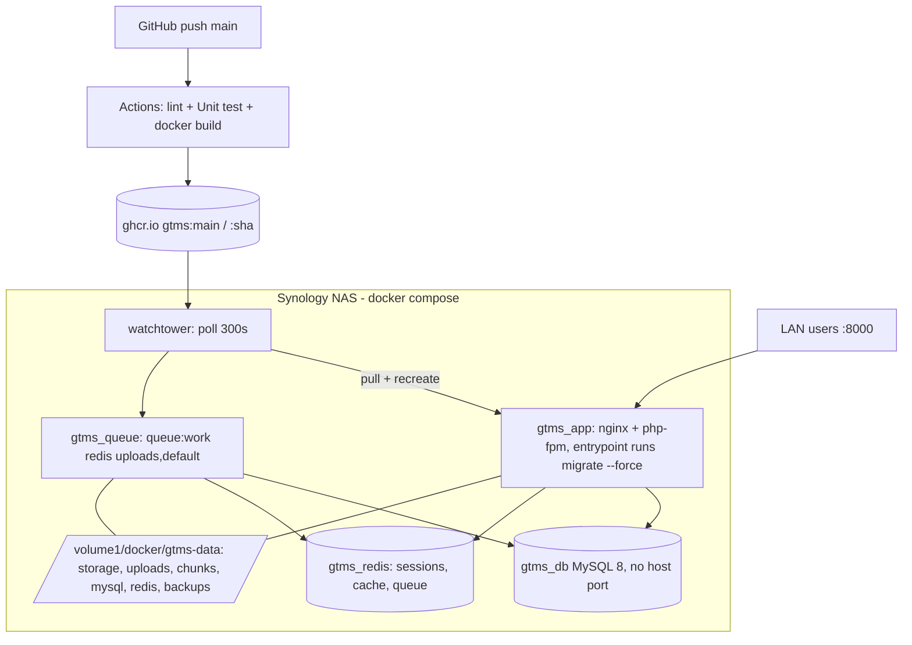

# 03 — System Architecture

> Index: [PROJECT_MASTER_INDEX.md](PROJECT_MASTER_INDEX.md). Related: [01-technology-stack.md](01-technology-stack.md), [15-cross-module-dependencies.md](15-cross-module-dependencies.md), [20-testing-deployment-configuration.md](20-testing-deployment-configuration.md).

## 1. Architectural style — VERIFIED

A **monolithic Laravel 12 MVC application with fat controllers**:

* Almost all business rules live in controllers. Only two service classes exist (`ChunkedUploadService`, `MasterPipelineService`).
* There are no Form Requests, Policies, Repositories, Events or DTOs.
* Validation is inline `$request->validate([...])`.
* Multi-step wizards keep their state in the **session** (`lease_draft`, `dgps_wizard`, `drone_wizard`, `ppt_wizard`, `ec_wizard`, `ec_compliance_wizard`, `enviro_b1_wizard`). They write to the DB on the final `store` / `submit`. The lease wizard also creates a DB draft row at step 1.
* The UI is server-rendered Blade with jQuery AJAX for modals and uploads. Master CRUD endpoints return `{status: 1|0, message, data}` JSON. Module endpoints return redirects or `{status/success, ...}` JSON depending on `ajax()` / `wantsJson()`.
* **Multi-tenancy** comes from the `BelongsToBranch` trait plus the `BranchScope` global scope (`app/Models/Traits/BelongsToBranch.php`, `app/Models/Scopes/BranchScope.php`). Users who are not Admin / Super Admin, and whose `role_id !== 1`, see only rows where `branch_id` equals their own.

## 2. Request pipeline

Note: `/api/upload/chunk/*` is in `routes/web.php` but **outside** the `auth` group. It gets the web middleware (session + CSRF) only.

## 3. Runtime topology (production, per docker-compose) — VERIFIED from files

## 4. Layering as actually implemented

| Layer | Implementation |
|---|---|
| Presentation | `resources/views/pages/<module>/{index,show,wizard}.blade.php`; the lease wizard uses `createstep1..8`; mining uses `mining-portal/*` |
| HTTP | One controller per module (see [05-controller-analysis.md](05-controller-analysis.md)); permissions are applied in routes, or in `HasMiddleware::middleware()` for the Accounts controllers |
| Domain | Controllers. Cross-module promotion logic lives in `CustomerController@moveToMining`, `MiningController@moveToEnvironment`, `EnverionsoneController@submit*ToPpt`, `PptDepartmentController@approvePresentation`, `EcCertificateController@store` and `MasterPipelineService` |
| Data | Eloquent models (58), `SoftDeletes` on 17 models, `BelongsToBranch` on 12 |
| Files | Two parallel roots: `public/uploads/...` (direct `move()`) and the `public` disk (`storage/app/public`, served via the `public/storage` symlink). See [16-file-upload-storage-system.md](16-file-upload-storage-system.md) |
| Async | Redis queue. Only the chunked-upload post-processing jobs use it |

## 5. Key architectural characteristics and consequences

1. **Departments are both a pipeline and separate silos.** Each module has its own application table, document table and numbering scheme. They link through nullable FKs (`lease_application_id`, `mining_application_id`, `environment_project_id`), the `common_id` string, and the later `master_projects` table. Two linking mechanisms coexist: the older per-controller "move to next module" actions, and the newer `master-pipeline` forward / return / resubmit actions. They do not update each other (see [13-business-workflows.md](13-business-workflows.md) §9).
2. **Status columns were converted from ENUM to free `VARCHAR(100)`** for most modules (`2026_09_26_100000_*`, `2026_10_29_000003_*`, `2026_10_29_000005_*`). Some `updateStatus` endpoints accept any string. The DB no longer enforces a status vocabulary.
3. **Document requirements are data-driven** through `modules → folders → document_fields` (plus `nature_of_work_id` for mining). Code also hard-codes IDs: `EnverionsoneController::ENV_MODULE_ID = 1`, and lease folders 7/8/9 with document field IDs 1–19 in `CustomerController@submit`.
4. **MySQL-specific SQL** is used: `ALTER TABLE ... MODIFY`, `SUBSTRING_INDEX`, `CAST ... AS UNSIGNED`. The app will not run on SQLite even though `.env.example` defaults to it.
5. **Production deploy is fully automatic** from `main` (Watchtower). Migrations run on container start and failures are swallowed (`migrate --force || true`).
