# 08 — Database Relationships

> Index: [PROJECT_MASTER_INDEX.md](PROJECT_MASTER_INDEX.md). Columns: [07-database-schema.md](07-database-schema.md).
> Provenance: REPOSITORY-DEFINED (migration FKs) plus model relations (`app/Models`). "(code only)" marks a link that exists in code but has no DB foreign key.

## 1. Core domain ER diagram

```mermaid
erDiagram
  BRANCHES ||--o{ USERS : "branch_id (code only)"
  ROLES ||--o{ USERS : "role_id (code only) + model_has_roles"
  USERS ||--o{ USERS : "user_id = creator"
  DISTRICTS ||--o{ CUSTOMERS : district_id
  MINERALS ||--o{ CUSTOMERS : mineral_id
  BRANCHES ||--o{ CUSTOMERS : branch_id
  CUSTOMERS ||--o{ LEASE_APPLICATIONS : "customer_id (restrict)"
  CUSTOMERS ||--o{ MINING_APPLICATIONS : "customer_id (restrict)"
  CUSTOMERS ||--o{ ENVIRONMENT_PROJECTS : "customer_id (restrict)"
  CUSTOMERS ||--o{ PPT_APPLICATIONS : "customer_id (restrict)"
  CUSTOMERS ||--o{ EC_CERTIFICATES : "customer_id (restrict)"
  CUSTOMERS ||--o{ EC_COMPLIANCES : "customer_id (restrict)"
  CUSTOMERS ||--o{ DGPS_SURVEYS : "customer_id (restrict)"
  CUSTOMERS ||--o{ DRONE_SURVEYS : "customer_id (restrict)"
  CUSTOMERS ||--o{ QUOTATIONS : "customer_id (restrict)"
  CUSTOMERS ||--o{ PAYMENT_RECEIPTS : "customer_id (restrict)"
  LEASE_CATEGORIES ||--o{ LEASE_APPLICATIONS : category_id
  LEASE_APPLICATIONS }o--o{ MINERALS : lease_application_minerals
  LEASE_APPLICATIONS ||--o{ LEASE_DOCUMENTS : cascade
  LEASE_APPLICATIONS ||--o{ MIMAS_CREDENTIALS : cascade
  LEASE_APPLICATIONS ||--o{ LEASE_SURVEY_NUMBERS : cascade
  LEASE_APPLICATIONS ||--o{ MINING_APPLICATIONS : "lease_application_id (null)"
  MINING_APPLICATIONS ||--o{ MINING_APPLICATIONS : parent_plan_id
  MINING_APPLICATIONS }o--o{ MINERALS : mining_application_minerals
  MINING_APPLICATIONS ||--o{ MINING_DOCUMENTS : cascade
  NATURE_OF_WORKS ||--o{ MINING_APPLICATIONS : nature_of_work_id
  MINING_APPLICATIONS ||--o{ ENVIRONMENT_PROJECTS : "mining_application_id (null)"
  LEASE_APPLICATIONS ||--o{ ENVIRONMENT_PROJECTS : "lease_application_id (null)"
  ENVIRONMENT_PROJECTS ||--o{ ENVIRONMENT_DOCUMENTS : cascade
  ENVIRONMENT_PROJECTS ||--o{ PPT_APPLICATIONS : "environment_project_id (null)"
  ENVIRONMENT_PROJECTS ||--o| PPT_APPLICATIONS : "ppt_stage_1_id / ppt_stage_2_id (code only)"
  PPT_APPLICATIONS ||--o{ PPT_DOCUMENTS : cascade
  ENVIRONMENT_PROJECTS ||--o{ EC_CERTIFICATES : "cascade"
  EC_CERTIFICATES ||--o{ EC_COMPLIANCES : "ec_certificate_id (null)"
  ENVIRONMENT_PROJECTS ||--o{ EC_COMPLIANCES : "environment_project_id (null)"
  EC_COMPLIANCES ||--o{ EC_COMPLIANCE_DOCUMENTS : cascade
  LEASE_APPLICATIONS ||--o{ DGPS_SURVEYS : "null"
  MINING_APPLICATIONS ||--o{ DGPS_SURVEYS : "null"
  DGPS_SURVEYS ||--o{ DGPS_DOCUMENTS : cascade
  LEASE_APPLICATIONS ||--o{ DRONE_SURVEYS : "null"
  DRONE_SURVEYS ||--o{ DRONE_DOCUMENTS : cascade
  MASTER_PROJECTS ||--o| LEASE_APPLICATIONS : "lease_application_id + lease.master_project_id"
  MASTER_PROJECTS ||--o| DGPS_SURVEYS : both directions
  MASTER_PROJECTS ||--o| DRONE_SURVEYS : both directions
  MASTER_PROJECTS ||--o| MINING_APPLICATIONS : both directions
  MASTER_PROJECTS ||--o| ENVIRONMENT_PROJECTS : both directions
  MASTER_PROJECTS ||--o| PPT_APPLICATIONS : both directions
  MASTER_PROJECTS ||--o{ PIPELINE_MOVEMENTS : cascade
  QUOTATIONS ||--o{ QUOTATION_ITEMS : cascade
  BANK_ACCOUNTS ||--o{ QUOTATIONS : bank_account_id
  QUOTATIONS ||--o{ PAYMENT_RECEIPTS : "quotation_id (null)"
  MODULES ||--o{ FOLDERS : cascade
  FOLDERS ||--o{ DOCUMENT_FIELDS : cascade
  FOLDERS ||--o{ LEASE_DOCUMENTS : folder_id
  DOCUMENT_FIELDS ||--o{ LEASE_DOCUMENTS : document_field_id
```

## 2. Soft (string) links — code only

| Link | Where | Risk |
|---|---|---|
| `common_id` (`GTMS-YYYY-NNNN`) on lease, mining, environment, PPT, DGPS, drone | Set by `CustomerController@moveToMining` (derived from `LA-YYYY-NNNN`), `MiningController::generateMiningAppNumber` (from the mining sequence), `MasterPipelineService::createOrGetMasterProject` / `associateDepartmentRecord` (from the master sequence), and migration `2026_09_16_095500` | Three generators can produce the same value for unrelated projects, or different values for the same project. Not a unique column. |
| `application_type` + `application_id` | application_handlers, application_payments, payment_receipts | No FK; the type vocabulary must match the literals in [06](06-model-analysis.md) §1 |
| `loggable_type` + `loggable_id` | activity_logs | Mixed vocabulary (`lease_application` vs FQCN) |
| `notifications.data->master_project_id` | notifications | JSON only |
| `ppt_stage_1_id`, `ppt_stage_2_id` | environment_projects → ppt_applications | No FK |
| `chunked_uploads.target_module` + `reference_id` | chunked_uploads → any module | Free string, also used as a **filesystem path** |

## 3. Delete behaviour summary
* **Customer** cannot be hard-deleted while any `restrict` child exists. App-level soft delete is blocked by `CustomerDirectoryController@destroy` when leases, mining, environment or PPT records exist. Surveys, EC, quotations and receipts are **not** checked by that guard, so a customer with only surveys or quotations can be soft-deleted (INFERRED from code).
* Deleting an application hard-cascades its documents. Soft-delete (the normal path) does not.
* `master_projects` deletion cascades `pipeline_movements` and nulls the department FKs.
