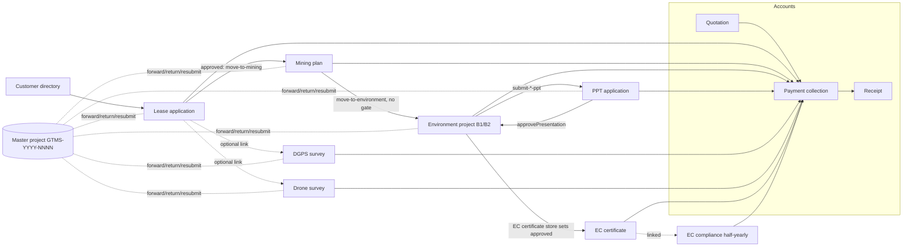
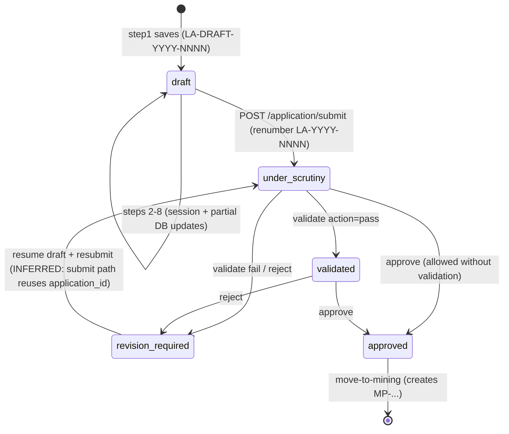
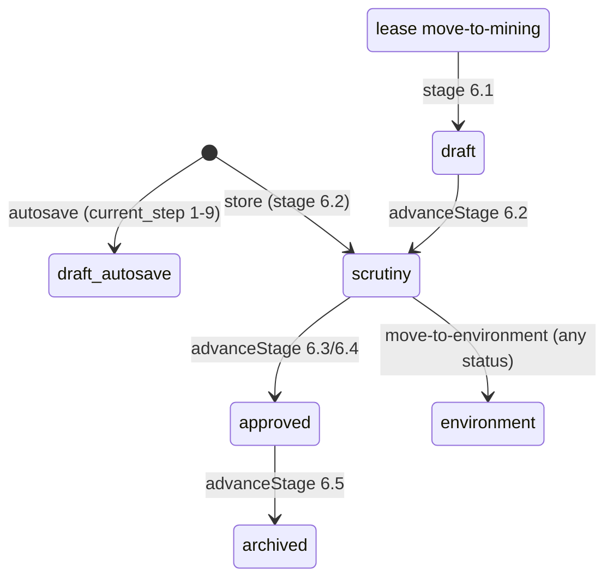
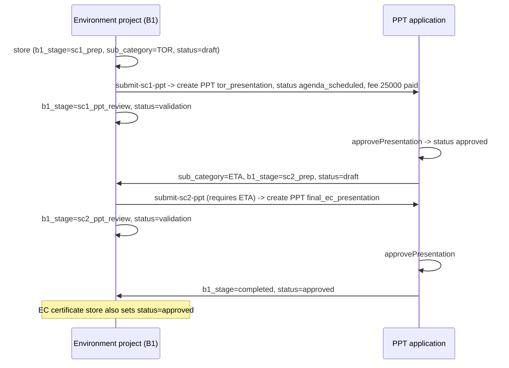
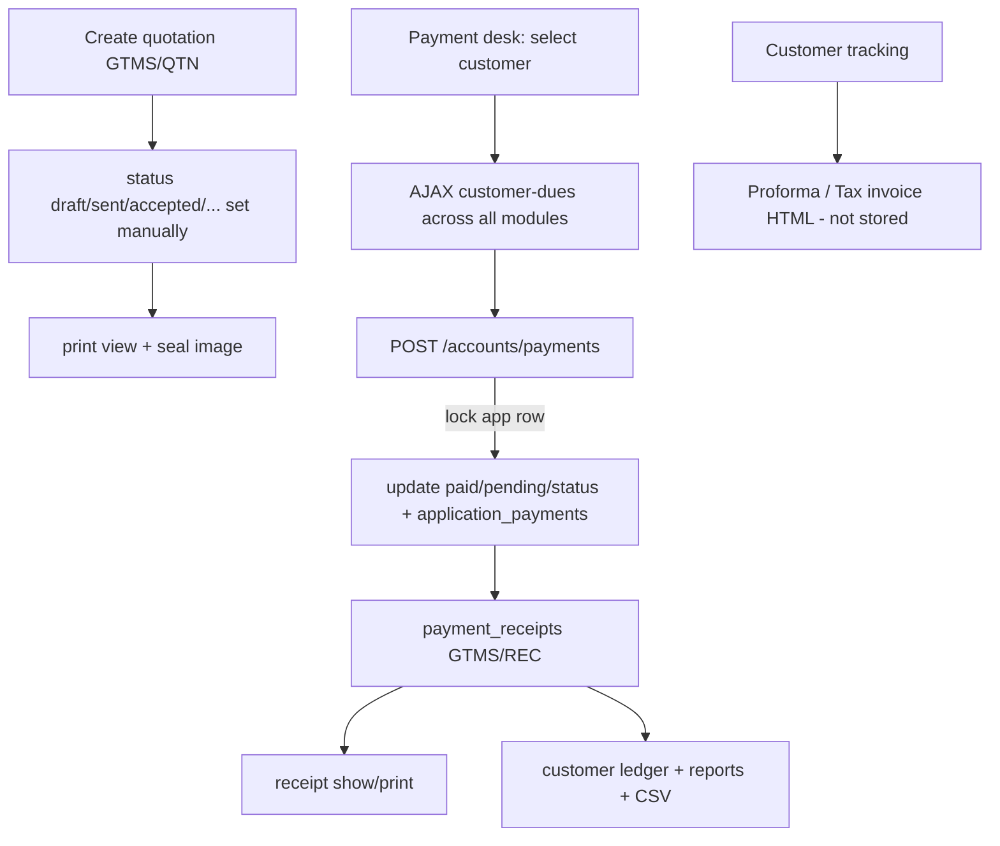
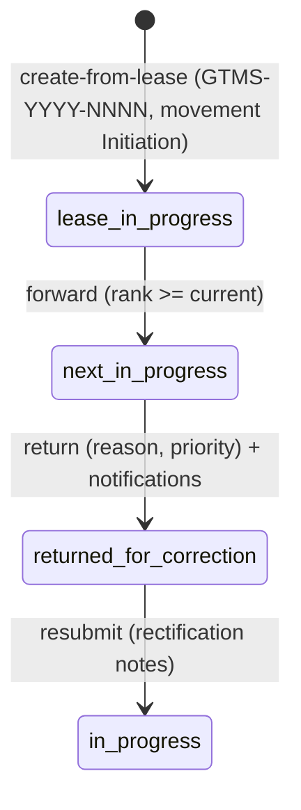

# 13 — Business Workflows

> Index: [PROJECT_MASTER_INDEX.md](PROJECT_MASTER_INDEX.md). Rules: [12-business-logic.md](12-business-logic.md). Diagrams reflect code paths that were read (VERIFIED) unless tagged otherwise.

## W0. End-to-end statutory journey (as the code links modules)

## W1. Lease application lifecycle

**Failure paths:** validation errors are returned as JSON 422. A missing session draft at `submit` produces whatever partial data exists in the session (PARTIALLY VERIFIED). A duplicate `application_no` raises a DB unique violation (possible for non-admin branch users; see [21](21-known-issues-risks.md) K5).
**Completion:** `approved`, plus a linked mining application.

## W2. Mining plan

Documents: upload → `uploaded`; validate → `validated` / `revision_required`.

## W3. Environmental clearance — B1 (two presentations)

## W4. Environmental clearance — B2
`store (B2, draft)` → `submit-b2-ppt` → PPT `b2_presentation` (`agenda_scheduled`), environment status `validation` → PPT approval → environment `approved`, `b1_stage = completed` → EC certificate.

## W5. EC certificate
Wizard steps (session `ec_wizard`, gated by `getMaxUnlockedStep`) → `store`: `updateOrCreate` by `ec_ref_no`, status `active`, handlers + `application_payments`, environment project → `approved`, activity log. Later `updateStatus` accepts any string (designed: active / expired / surrendered / revoked; no expiry automation).

## W6. EC compliance (half-yearly)
8-step wizard → `store` (`HYC-YYYY-NNNN`, status `uploaded_to_parivesh`, documents in 4 folder categories) → `updateStatus` (free text; designed path draft → documents_collected → lab_analysed → report_prepared → uploaded_to_parivesh → completed → archived). Note: store **skips** to `uploaded_to_parivesh`.

## W7. DGPS / Drone surveys
6-step wizard → `store` (DGPS: `completed` + `verified` immediately; Drone: default `deliverables_ready`) → document upload / remove. No transition endpoints exist for surveys apart from the master pipeline's `updateDepartmentRecordStatus`.

## W8. Accounts

## W9. Master pipeline (parallel mechanism)

**Interaction with the module buttons:** `moveToMining`, `moveToEnvironment` and `submit*ToPpt` do **not** create pipeline movements or update `master_projects.current_stage`. The pipeline's `forward` does not create department records; it only links IDs passed in the payload. The two mechanisms can therefore disagree about where a project is (VERIFIED by reading both code paths; no shared call).

## W10. Large file upload
init → chunks (retry, resume) → assemble (stream, SHA-256) → job chain (MIME detection, checksum verification, video thumbnail) → the module endpoint links the file to a document row through `upload_token`.
